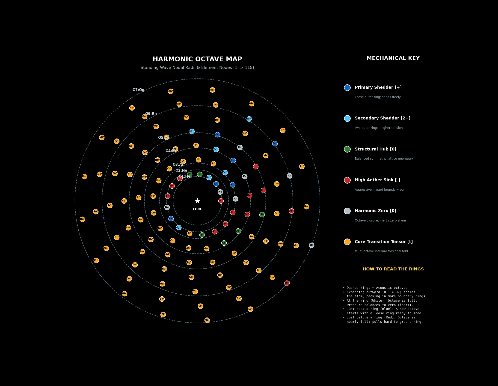

# Periodic & Atomic Harmonics Module

## Overview

This directory houses the foundational models of atomic structure and recursive chemical bonding within the **Scalar Relaxation Cosmology (SREC)** framework. Rather than treating elements as probability clouds governed by quantum mechanical wavefunctions, SREC models atoms as physical, standing-wave nodal structures sustained by electrostatic and aetheric boundary pressures across expanding acoustic octaves.

---

## Harmonic Octave Map (Z: 1 — 118)

The core visualization plate (`harmonic_spiral_map.pdf` / `.png`) maps all 118 elements onto fixed radial steps along an expanding spiral, bounded by acoustic octave rings anchored at the noble gas closures.



### Mechanical Archetypes & Key

Elements are classified into six mechanical archetypes governing their boundary interactions and reaction pathways:

* **Primary Shedder [⁺]** (Blue): Loose outer ring; sheds freely (Alkali metals).
* **Secondary Shedder [²⁺]** (Light Blue): Two outer rings; higher tension (Alkaline earth metals).
* **Structural Hub [0]** (Green): Balanced symmetric lattice geometry (Carbon, silicon, network formers).
* **High Aether Sink [⁻]** (Red): Aggressive inward boundary pull (Halogens, non-metal oxidizers).
* **Harmonic Zero [0]** (White): Octave closure; inert / zero shear (Noble gases).
* **Core Transition Tensor [ᵗ]** (Gold): Multi-octave internal torsional fold (Transition metals, lanthanides, actinides).

### How to Read the Rings

* **Dashed Rings:** Represent standing-wave acoustic octaves ($O_1$ through $O_7$).
* **Radial Scaling:** Expanding outward ($O_1 \to O_7$) scales the atom, packing in increasing boundary rings.
* **At the Ring (White / Noble):** The octave is full. Pressure balances to zero (inert).
* **Just Past a Ring (Blue / Alkali):** A new octave starts with a loose ring ready to shed.
* **Just Before a Ring (Red / Halogen):** The octave is nearly full; pulls hard to grab a ring.

---

## Recursive Reaction Engine (`reaction_engine_v5.py`)

The reaction engine computes molecular stoichiometry and binding energy release directly from geometric boundary capacities ($\tau$, frequency, pressure differential $\Delta P$, and open slots) without empirical lookup tables.

### Key Principles

1. **Geometric Saturation:** Bonds form not via energy activation thresholds alone, but through complete boundary engagement. An interlocked partner engages its *entire* open boundary configuration.
2. **Structural Hub Auto-Orientation:** Assemblies automatically orient around the node with the most open boundary positions.
3. **Emergent Stoichiometries:** Standard molecules—such as $\text{CH}_4$, $\text{OH}_2$ (water), $\text{NH}_3$, $\text{CO}_2$, $\text{SiO}_2$, $\text{CCl}_4$, $\text{MgCl}_2$, and $\text{AlCl}_3$—fall naturally out of boundary capacities and recursive step saturation.

### Execution

Run the reaction engine directly to simulate binary ionic snaps, covalent locks, and noble rejections:

```bash
python reaction_engine_v5.py
```
